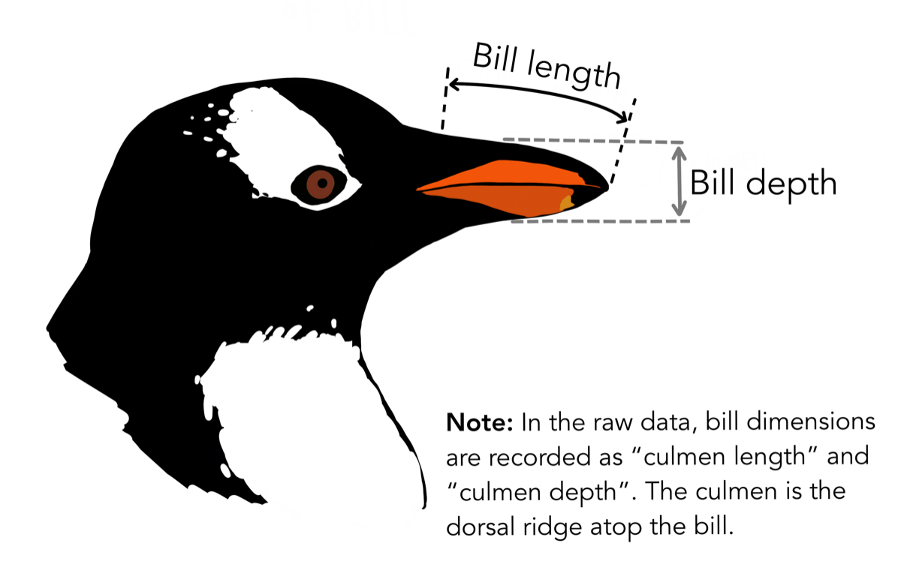
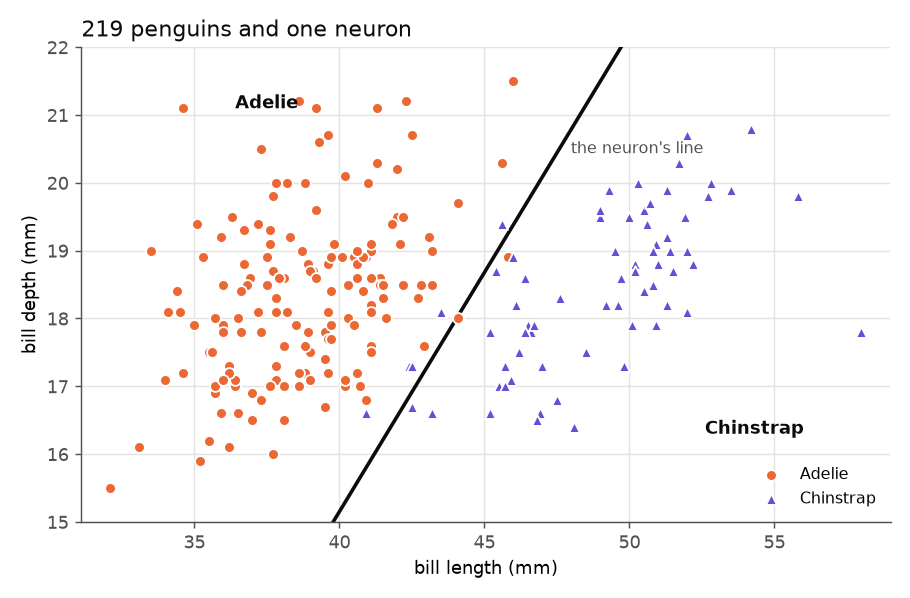

# A neuron is a weighted vote

*Deep Learning from Scratch, part 1. Code: [`samples/01-neuron`](../samples/01-neuron).

In Cuba, the night before a Santiago de Cuba vs Industriales baseball game, everybody
is an expert.

I grew up in Moa, in Holguín, and moved to Havana before high school. If you
arrive in Havana from Oriente, the kids let you know it every day. They call
you *palestino*, they make fun of your accent, and when Santiago comes to town,
you're automatically the enemy. I got a lot of that. But I also got a
front-row seat to the arguments, on the corner and in the line for bread,
and I noticed that everyone's method was the same.

They weigh the signs. *Who's pitching tomorrow? Who won the last series? Are
they playing at the Latinoamericano or at the Guillermón Moncada? Is the
cleanup hitter in a slump?* Not all the signs count the same. The starting
pitcher counts a lot, the last series counts some, and what the commentator
said on the radio counts... let's say *very little*.

And before anyone looks at a single sign, they already lean one way. In
Havana the starting opinion is "Industriales wins". In Santiago it's the
opposite. Nobody needs data for that part.

Every one of those people on the corner was, without knowing it, a neuron.

## Why start here

Every AI tool you've used this year is built from this one tiny idea. That
includes the chatbot that writes your emails, the assistant that completes your
code, and the phone that recognizes your face. They contain no rules
written by a person, just a huge number of these weighted votes, each one
with its trust levels learned from examples. The big language models have
billions of them.

You can't understand the billions until you've built one by hand. So let's
build one, in C# and in Python, and teach it to tell two kinds of penguins
apart.

There are no penguins in Cuba. The coldest thing we have is a January morning
at 18 °C, when everyone puts on a jacket. Growing up, penguins were like most
things from the outside world: something you could only dream about. I chose
them anyway, because the data is lovely.

## The data

The [Palmer Penguins](https://allisonhorst.github.io/palmerpenguins/) dataset
measures 344 penguins from three islands in Antarctica. I kept the two species
that are hardest to tell apart, Adelie (151 birds) and Chinstrap (68), and two
measurements of each: **bill length** and **bill depth**.


*We'll use the Chinstrap (left) and the Adelie (right). Artwork by @allison_horst.*



*Bill length runs along the top of the beak; bill depth is its height. Artwork by @allison_horst.*

Here's a penguin with a bill 46 mm long and 17 mm deep. Adelie or Chinstrap?
Hold that thought.

Before training anything, I set aside every 4th penguin as a **test set**:
54 penguins the model never sees while learning. It's like the exam at the end
of the course. If you grade a student with the same exercises they practised
on, you learn whether they memorized, not whether they understood.

## The vote, written down

Here's the corner-expert method in code:

```
z = w1 * length + w2 * depth + b      // the vote
p = 1 / (1 + e^-z)                    // turned into a probability
```

- **`w1` and `w2` are the weights:** how much each sign is trusted. A positive
  weight votes "Chinstrap", a negative one votes "Adelie", and a bigger number
  is a louder vote. On the corner, the starting pitcher had the biggest weight.
- **`b` is the bias:** the opinion before looking at anything. In Havana,
  "Industriales wins". (Yes, in machine learning *bias* is literally the
  word for this.)
- **The second line is the sigmoid.** It squashes any total into a number
  between 0 and 1 that we can read as a probability. A very positive vote gives
  almost 1 ("surely a Chinstrap"), a very negative one gives almost 0, and a
  vote of exactly 0 gives 0.5, a shrug.

The places where the vote is exactly 0 form a line on the chart, the
neuron's **decision boundary**. Penguins on one side are called Chinstraps,
those on the other side Adelies.

This model is older than deep learning and has its own name: **logistic
regression**. Every network in this series, up to the Transformer in post 20,
is this same computation stacked many times.

## The part nobody explains: where do the weights come from?

The corner experts learned their weights over decades of games. Our neuron
starts with every weight at zero, so it knows nothing, and learns them in a
fraction of a second. It needs two things.

### 1. A way to measure how wrong it is

For each penguin, the neuron gives a probability that it's a Chinstrap. We
charge it a penalty called the **log loss**:

- if the penguin *was* a Chinstrap, the penalty is `-log(p)`;
- if not, the penalty is `-log(1 - p)`.

In practice: saying 0.9 when the answer is "yes" costs 0.1, a small fee.
Saying 0.01 when the answer is "yes" costs 4.6, a big one. **Being sure and
wrong is punished hardest**, which is exactly what you want. A forecaster who
says "100% sunny" on the day of a hurricane should lose their job; one who said
"60% sunny" just had a bad day.

The **loss** is the average penalty over all the training penguins. Learning
means making that number small.

### 2. A way to make it less wrong

Picture yourself on a hill in thick fog, trying to reach the bottom. You can't
see the valley, but you can feel the slope under your feet. So you take a
small step downhill, feel again, and take another step.

That's **gradient descent**. For each weight, the computer asks: *if I nudge
this weight up a little, does the loss go up or down, and by how much?* That
slope is the **gradient**. Every weight takes a small step downhill. The size
of the step is the **learning rate**. Repeat a thousand times.

For one neuron, the slope has a surprisingly friendly form:

```
error  = p - y                  // y is 1 for Chinstrap, 0 for Adelie
dw1    = average(error * length)
dw2    = average(error * depth)
db     = average(error)
```

Read it as: *each penguin pushes each weight in proportion to how wrong the
guess was and how big that measurement was.* A penguin the neuron already gets
right, confidently, has an error close to 0 and pushes nothing. The neuron
learns only from its mistakes, which is more than you can say for some
governments. (In part 3 we'll derive this formula properly. For now, trust
the fog.)

### One small preparation: same units for every sign

Bill lengths are around 40 mm and depths around 18 mm. If we feed those raw
numbers in, length gets a louder voice just because its numbers are bigger.
So we **standardize**: for each measurement, subtract its average and divide
by its spread (the standard deviation). Afterwards both are centred on 0 with
the same spread, and they compete fairly.

One detail matters here: compute the average and spread using the training
penguins only, then apply those same numbers to the test penguins. If you use
the test penguins to compute them, a little of the exam has leaked into the
studying.

## The code

### C#

No libraries, just arrays, loops and a bit of LINQ. Here's the heart of it:

```csharp
for (int step = 0; step <= 1000; step++)
{
    double loss = 0, dw0 = 0, dw1 = 0, db = 0;
    foreach (int i in trainIdx)
    {
        double p = Predict(Xs[i]);                  // predicted chance of Chinstrap
        loss -= y[i] * Math.Log(p) + (1 - y[i]) * Math.Log(1 - p);
        double dz = p - y[i];                       // how wrong this prediction was
        dw0 += dz * Xs[i][0];
        dw1 += dz * Xs[i][1];
        db += dz;
    }
    w[0] -= learningRate * dw0 / n;
    w[1] -= learningRate * dw1 / n;
    b -= learningRate * db / n;
}

double Sigmoid(double z) => 1 / (1 + Math.Exp(-z));
double Predict(double[] x) => Sigmoid(w[0] * x[0] + w[1] * x[1] + b);
```

### Python

Same thing with numpy. The loop over penguins disappears, because
`X_train @ w` computes every penguin's vote at once:

```python
for step in range(1001):
    p = sigmoid(X_train @ w + b)                 # predicted chance of Chinstrap
    loss = -np.mean(y_train * np.log(p) + (1 - y_train) * np.log(1 - p))
    dz = p - y_train                             # how wrong each prediction was
    w -= learning_rate * (X_train.T @ dz) / n
    b -= learning_rate * dz.mean()
```

Both start with every weight at 0, use a learning rate of 0.1 and take 1,000
steps. And both print exactly this, digit for digit:

```
step    0  loss 0.6931
step  200  loss 0.1468
step  400  loss 0.1054
step  600  loss 0.0887
step  800  loss 0.0794
step 1000  loss 0.0733

weights: bill length +4.417, bill depth -1.387, bias -1.968
train accuracy 97.0%  (165 penguins)
test  accuracy 96.3%  (54 penguins)
always guessing Adelie: 68.5%
```

That first loss, 0.6931, is `log 2`, the price of a pure shrug: with every
weight at zero, the neuron says 0.5 for every penguin.



The weights read like a sentence: **a long bill votes strongly for Chinstrap,
and a deep bill votes a little for Adelie.** Seven of the 219 penguins sit on
the wrong side of the line. No straight line can fix those, and that will be
the whole point of part 2.

And the penguin from the beginning, 46 mm by 17 mm? The neuron says
**Chinstrap, with a probability of 0.94.**

## Three things I almost got wrong

**1. 96.3% sounds great until you ask "compared to what?"** In baseball,
hitting .300 makes you a star, but only because the league average is around
.250. A number means something only next to its baseline. Here, 68.5% of the test
penguins are Adelies, so a "model" that answers Adelie every time, learning
nothing, already scores 68.5%. Our 96.3% is good *because* it's far above
that, not because it's a big number. Always put the dumbest possible answer
next to your result.

**2. The accuracy said everything was fine. It wasn't.** Out of curiosity I
removed the standardization step and kept the learning rate at 0.1:

```
step    0  loss 0.6931
step  200  loss nan
...
test  accuracy 96.3%
```

The loss became `nan`, "not a number". With raw millimetres, steps of size
0.1 are far too big, a bit like sweetening a cafecito by emptying the sugar
bowl instead of adding a spoon. The votes grew so large that the sigmoid
returned exactly 1.0 or 0.0, and the loss tried to compute `log(0)`. The model
was broken inside. **And the accuracy still read 96.3%.** If I had watched
only accuracy, I would never have noticed. (A smaller learning rate, 0.01,
trains fine on the raw numbers. The point isn't that standardizing is
mandatory. It's that the loss is the instrument that tells you something is
off.)

**3. Weights only mean something when the inputs share units.** In that raw
run with learning rate 0.01, the final weights were +0.730 for length and
-1.775 for depth. Depth looks 2.4 times more important. In the standardized
run, the same data gives +4.417 and -1.387, so **length** matters 3.2 times
more. A raw weight mixes "how important is this?" with "what units is this
in?". Compare weights only after the inputs are on the same scale.

## What one neuron can't do

The corner method has a limit, and so does ours. However you set the
weights, the boundary is always a straight line (with more measurements, a
flat plane). Many real problems aren't split by a straight line. In part 2 we
put a few neurons side by side, a **hidden layer**, and watch the line bend.

The one thing to remember: **a neuron is a weighted vote, and learning is
adjusting how much to trust each voice, one small step downhill at a time.**

## Run it yourself

```bash
git clone https://github.com/jjcolumb/deep-learning-from-scratch
cd deep-learning-from-scratch/samples/01-neuron

cd csharp && dotnet run          # .NET 10
cd ../python && python main.py   # numpy
```

*Data: Palmer Penguins, Horst, Hill & Gorman (2020), CC0. Penguin artwork by @allison_horst.*
