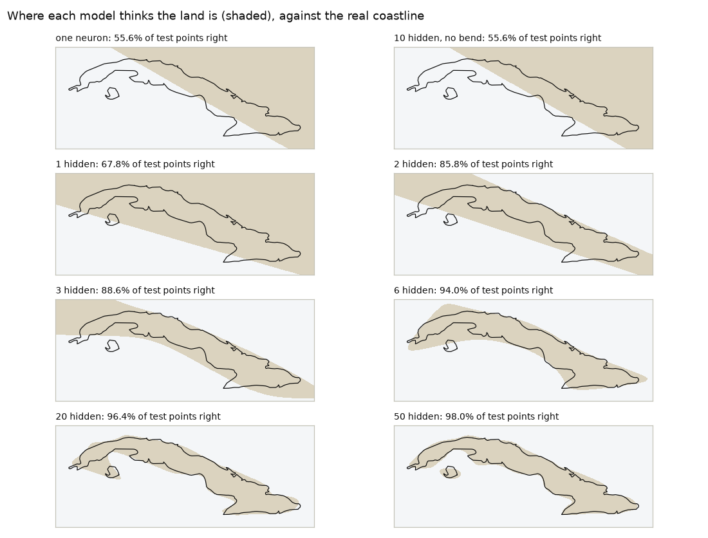
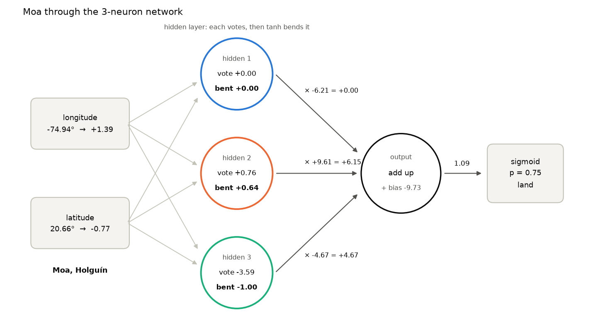
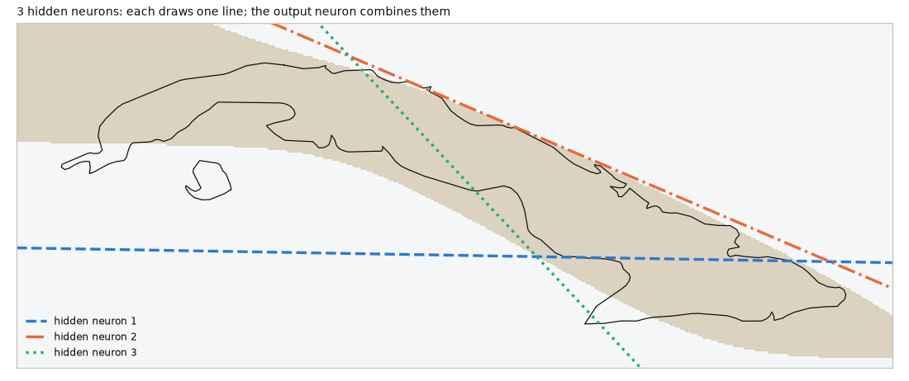

# One neuron can't draw Cuba

*Deep Learning from Scratch, part 2. Code: [`samples/02-hidden-layer`](../samples/02-hidden-layer).*

> **In short:** one neuron can only split the world with a straight line. Put
> a few neurons side by side (a *hidden layer*), bend their answers, and let
> one more neuron combine them, and the network can draw almost any shape, even
> the island of Cuba. Without the bend, extra layers add nothing.

Every Cuban kid can draw Cuba from memory. You learn it in school, the long
island lying on its side, and you learn what it looks like: a caimán, an
alligator. Nicolás Guillén called it *"un largo lagarto verde"*, a long green
lizard, and the name stuck.

When I moved from Moa to Havana, I crossed almost the whole length of that
lizard, from near its eastern tip to the west. It isn't a straight trip. The
island curves, it gets thin, then fat, then thin again.

Now imagine trying to draw it with a ruler, in one stroke. You can't. A ruler
gives you a straight line, and Cuba is anything but straight.

In [part 1](01-a-neuron-is-a-weighted-vote.md) we built a neuron, and at the end
we found its limit: **a single neuron is a ruler**. Whatever weights it
learns, it can only split the world with one straight line. In this post we
give it a problem that no ruler can solve, drawing Cuba, and watch what it
takes to solve it.

## Why this matters

Almost nothing interesting in the real world is separated by a straight line.
Whether a photo shows a frog, whether an email is spam, what word comes next in
a sentence: all of them need boundaries that bend and twist.

The trick that makes those boundaries possible is in this post. It's also
where the word *deep* in deep learning comes from: layers of neurons between
the input and the answer, called **hidden layers**. Today we build the
smallest possible version, with one hidden layer. Everything bigger is the same
idea, repeated.

## The data: a map, as points

I took the coastline of Cuba (from [Natural Earth](https://www.naturalearthdata.com/),
a public-domain map) and scattered random points over the box around it. Each
point is two numbers, **longitude and latitude**, and a label: **land (1)** or
**sea (0)**. I kept 1,000 of each, so a coin flip scores 50%.

As before, every 4th point is set aside as the test set: 1,500 points to learn
from and 500 to grade with. 51.6% of the test points happen to be land, so
"always say land" scores 51.6%. That's our baseline.

The model never sees the coastline. It only sees points and labels, and it has
to figure out the shape of Cuba from them.

## First, the ruler

Our neuron from part 1, unchanged, on this data:

| model | test accuracy |
|---|---|
| always say "land" | 51.6% |
| one neuron | **55.6%** |

Four points better than doing nothing. Here's why:



Look at the top-left map. The neuron did the best a ruler can do: it drew a
diagonal line and called everything above it land. That catches the eastern
half of the island and a lot of sea with it. It isn't a bad neuron; the
problem is just beyond what one straight line can do.

## The idea: neurons that vote on other neurons' votes

Here's the fix. Instead of one neuron looking at the inputs, put **several**
neurons there, each with its own weights. Each of them draws its own straight
line. Then add **one more neuron at the end** that doesn't look at the map at
all. It looks at what the first neurons said and votes on their votes.

```
longitude, latitude  →  [ hidden layer: h neurons ]  →  [ output neuron ]  →  land or sea?
```

The neurons in the middle are the **hidden layer**. They're "hidden" because
nobody tells them what to do. We never say "you watch the north coast, you
watch the east". They figure out their jobs during training.

Think of a baseball manager deciding whether to change pitchers. He doesn't
look at raw numbers himself. He asks the pitching coach ("his arm looks
tired"), the catcher ("his slider isn't breaking"), and the bench coach ("the
next three hitters crush lefties"). Each one has their own view. The manager
weighs *their opinions* and decides. The coaches are the hidden layer; the
manager is the output neuron.

## The secret ingredient: the bend

There's one catch, and it's the most important idea in this post.

Each hidden neuron computes a weighted vote, the same `w1 * x + w2 * y + b`
as before. If we pass those raw votes straight to the output neuron, something
disappointing happens. A weighted sum of weighted sums is still just a
weighted sum. You can expand the algebra and it collapses back into **one
straight line**. Ten neurons in a row, all saying the same straight thing in
different words.

So between the layers, we bend each vote with a function called **tanh**
(hyperbolic tangent, a cousin of the sigmoid from part 1). It squashes any
number into the range from -1 to 1: big positive votes become almost 1, big
negative ones almost -1, and votes near 0 pass through almost unchanged.

That squashing is the bend. Now each hidden neuron reports something closer to
*"yes / no / not sure"* than a raw score, and combining yes/no answers from
several lines lets the output draw corners, strips and curves. A function used
like this, between layers, is called an **activation function**. Without it,
depth is an illusion.

In code, the whole forward pass, the trip from input to answer, is:

```
z1 = W1 · x + b1        // each hidden neuron's vote
a1 = tanh(z1)           // ...bent
z2 = W2 · a1 + b2       // the output neuron votes on their votes
p  = sigmoid(z2)        // probability of land
```

Here's a real trained network with 3 hidden neurons (the one we'll open up
later in this post) deciding about one point: **Moa**.



Follow the numbers from left to right:

- **Hidden 1** happens to have its line running right through Moa, so its
  vote is exactly 0 and the bend keeps it at 0. *"No opinion."* It
  contributes nothing.
- **Hidden 2** votes a mild yes (+0.76, bent to +0.64). The output trusts
  this neuron a lot (weight +9.61), so it adds +6.15.
- **Hidden 3** is confident: its vote of -3.59 is bent all the way to -1.00,
  a firm *"no"*. But the output's weight for it is negative (-4.67), so a firm
  "no" from this neuron counts as **+4.67 for land**. A hidden neuron's
  "yes" and "no" don't mean land or sea by themselves. They mean whatever the
  output learns to read into them.
- **The output's bias is -9.73.** It starts out very skeptical, and it only
  says "land" when several hidden neurons agree.

Total: 0 + 6.15 + 4.67 - 9.73 = **1.09**, and the sigmoid turns that into
**0.75: land**. Correct, Moa is very much on land. Notice that no single
hidden neuron said "land". The answer came from combining them.

## How it learns: blame flows backwards

Training works exactly as in part 1: measure the log loss, find the slope for
every weight, take a small step downhill. The new question is how the hidden
weights get their slopes. Nobody told the hidden neurons what the right
answer was. They only know what the output neuron did with their votes.

The answer is that **blame flows backwards**:

```
dz2 = p - y                           // how wrong the output was (same as part 1)
dW2 = average(dz2 * a1)               // output weights: same rule as part 1

dz1 = dz2 * W2 * (1 - a1²)            // each hidden neuron's share of the blame
dW1 = average(dz1 * x)                // hidden weights: same rule again
```

The third line is the heart of it. A hidden neuron's share of the blame is:

- **how wrong the output was** (`dz2`),
- times **how much the output listened to that neuron** (`W2`): if the
  manager ignored the catcher, the catcher isn't to blame;
- times **how much that neuron could have changed its answer** (`1 - a1²`,
  the slope of tanh): a neuron already shouting a confident "yes" (close to 1)
  barely moves, so it gets little blame.

That process of passing blame backwards through the layers is called
**backpropagation**. In part 3 we'll derive it properly, for any number of
layers, and learn how to check that we got it right.

## One more thing: start with random weights

In part 1 every weight started at zero. Here they can't. If every hidden
neuron starts with the same weights, they all draw the same line, get the same
blame, and take the same step. They stay identical forever, ten copies of one
neuron. (That's the libreta problem, and it gets its own post: part 4.)

So the weights start as small random numbers. To make C# and Python start from
the *exact same* random numbers, both versions include the same tiny random
number generator (SplitMix64, ten lines), seeded with 42.

## The code

### C#

The network is a small class. Here's the forward pass and the training step:

```csharp
(double[] a1, double p) Forward(double[] x)
{
    var a1 = new double[hidden];
    double z2 = b2;
    for (int j = 0; j < hidden; j++)
    {
        double z1 = x[0] * W1[0, j] + x[1] * W1[1, j] + b1[j];   // each hidden neuron's vote
        a1[j] = Tanh(z1);                                          // ...bent
        z2 += a1[j] * W2[j];                                       // the output votes on their votes
    }
    return (a1, Sigmoid(z2));
}

// inside the training loop, for each point i:
var (a1, p) = Forward(X[i]);
double dz2 = p - y[i];                                 // how wrong the output was
for (int j = 0; j < hidden; j++)
{
    dW2[j] += a1[j] * dz2;
    double dz1 = dz2 * W2[j] * (1 - a1[j] * a1[j]);    // blame flows back
    dW1[0, j] += X[i][0] * dz1;
    dW1[1, j] += X[i][1] * dz1;
    db1[j] += dz1;
}
db2 += dz2;
```

After each pass over the 1,500 points, every weight takes a step: `W -= learningRate * dW / n`.

### Python

The same thing, with numpy handling all 1,500 points at once:

```python
Z1 = X[:, :1] * W1[0] + X[:, 1:] * W1[1] + b1    # each hidden neuron's vote
A1 = tanh(Z1)                                    # ...bent
p = sigmoid(A1 @ W2 + b2)                        # the output votes on their votes

dz2 = p - y                                      # how wrong the output was
dz1 = dz2[:, None] * W2 * (1 - A1 * A1)          # blame flows back
```

(The real file adds up in a specific order, for a reason you'll see in a
minute.)

Both train for 20,000 steps with a learning rate of 1.0. That's ten times
bigger than part 1's 0.1. There's no universal right value; you find it by
trying. Then they print exactly the same table:

```
1500 training points, 500 test points, 51.6% of the test points are land

model                          train    test
one neuron                     59.8%   55.6%
10 hidden, no bend             59.8%   55.6%
1 hidden, tanh                 68.7%   67.8%
2 hidden, tanh                 87.9%   85.8%
3 hidden, tanh                 89.3%   88.6%
4 hidden, tanh                 92.3%   92.2%
6 hidden, tanh                 94.5%   94.0%
10 hidden, tanh                95.8%   95.0%
20 hidden, tanh                97.7%   96.4%
50 hidden, tanh                98.8%   98.0%
```

## Watching the lizard appear

Go back to the maps above and read them in order.

- **1 hidden neuron (67.8%)** is still a ruler, just a better-placed one.
  With one coach, the manager can only agree or disagree with him.
- **2 hidden neurons (85.8%)** make a **strip**: two parallel-ish lines, land
  between them. The lizard's body, roughly.
- **3 hidden neurons (88.6%)** start to bend the strip.
- **6 (94.0%)** is the first map you'd recognize as Cuba.
- **50 (98.0%)** even finds the Isla de la Juventud, the little island to the
  south-west.

Here's the 3-neuron network opened up. Each dashed line is one hidden neuron's
straight line. None of them looks like Cuba. The output neuron, combining
their bent votes, carves out the shaded region:



That's the whole trick of deep learning in one picture: **simple pieces, each
drawing a straight line, combined through a bend, make a shape none of them
could draw alone.**

## Three things I almost got wrong

**1. Layers without the bend are just bureaucracy.** Look at the second row
of the table: ten hidden neurons, no tanh, **55.6%**, exactly the same as the
single neuron, to the decimal. On the map they draw the same diagonal line.
Ten officials passing the same memo up the chain, each one adding a stamp:
more layers, more paperwork, and the decision that comes out at the top is
still the same straight line from 1959. Depth without an activation function
adds cost and changes nothing.

**2. "Too many neurons will overfit."** I'd read that a big hidden layer
would start drawing silly bumps around individual points and get worse,
which is called **overfitting**. It's a real danger, and part 5 is all about
it. But here, measured on the test points it never trained on, the 50-neuron
network scores 98.0%, the best of all. The boundary *looks* wigglier, and
it's also right more often. You can't judge overfitting by how a picture
looks. You judge it with a test set.

**3. C# and Python disagreed, and both were right.** My first version
printed 87.9% for "2 hidden" in Python and 87.5% in C#. Same data, same
starting weights, same formulas. The culprit is that computers don't add
decimals exactly:

```
(0.1 + 0.2) + 0.3  =  0.6000000000000001
0.1 + (0.2 + 0.3)  =  0.6
```

numpy adds long lists in a different order than a C# `for` loop, so the last
digit of a sum can differ. numpy's `tanh` also differs from .NET's
`Math.Tanh` in the last digit for about one input in five. One digit out of
sixteen seems harmless, but training repeats the same calculation 20,000
times, and each step builds on the last one. The 2-neuron network was
sensitive enough that the tiny difference grew into a different final answer.
The fix was to make both versions add in the same order and compute tanh the
same way, from `exp`. If you ever need two systems to produce *identical*
results, from a model or from a financial report, the order of operations is
part of the specification.

## What's next

We now have a network that learns shapes, and we wrote the backward pass for
exactly one hidden layer by hand. That doesn't scale. Real networks have
dozens of layers. In part 3 we'll write backpropagation once, for any number of
layers. Then we'll learn how to check that it's correct, because a bug in the
gradients usually doesn't crash anything: the network just learns worse, and
nothing tells you why. After that, we'll let a framework do it for us.

The one thing to remember: **a hidden layer is a team of rulers, and the bend
between layers is what lets the team draw curves.**

## Run it yourself

```bash
git clone https://github.com/jjcolumb/deep-learning-from-scratch
cd deep-learning-from-scratch/samples/02-hidden-layer

cd csharp && dotnet run -c Release   # .NET 10, ~35 s
cd ../python && python main.py       # numpy, ~20 s
```

*Coastline: Natural Earth, public domain.*
