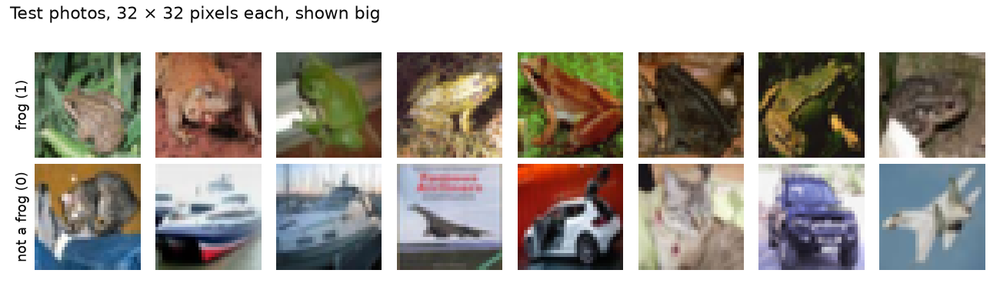
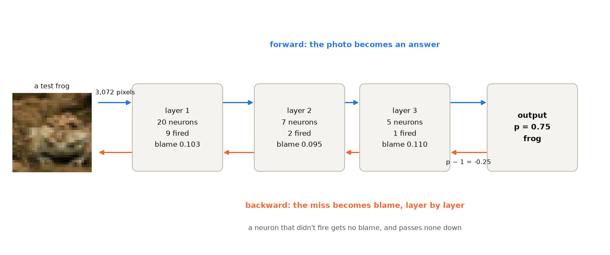
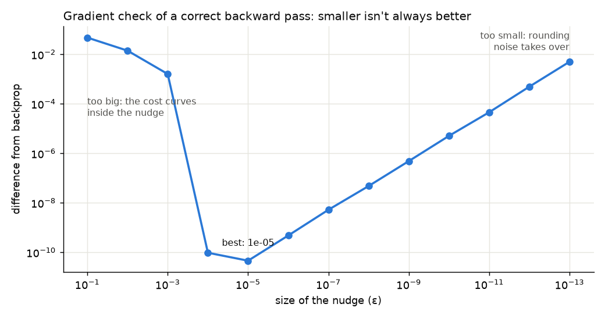

# Blame flows backwards

*Deep Learning from Scratch, part 3. Code: [`samples/03-backprop`](../samples/03-backprop).*

> **In short:** after a network gives a wrong answer, *backpropagation*
> works out how much each weight is to blame, starting at the answer and
> walking back one layer at a time. We write it once, for any number of
> layers, and teach a network to spot frogs in photos. Then we learn to check
> it, because a backprop bug doesn't crash anything: the network just learns
> worse. Finally we let PyTorch do the whole thing in one line.

In 1969 one phrase was everywhere in Cuba: *"¡Los diez millones van!"*, the
ten million are coming. The 1970 sugar harvest, the *Zafra de los Diez
Millones*, was going to produce ten million tons of sugar, more than the
island had ever made, and prove to the world that the plan worked.

The whole country went to the cane fields. Students, soldiers, office
workers, people who had never held a machete, loaded onto trucks before
sunrise. The mills ran day and night. The slogan grew a second half, *"de que
van, van"*, they're coming no matter what. And a young band in Havana took
the name Los Van Van from it. (Or so I remember it. I may be making this up,
but I think I heard it from my dad.)

The ten million never came. The harvest ended at about eight and a half
million tons: a record, and still a miss. The band did better. They're still
playing.

Now picture the planner's office the morning after. Knowing that you missed
is the easy part. The hard part is the next question: **how much did each
piece of the plan contribute to the miss, and which way should each piece
change?** Was it the fields? The trucks that broke down on the way to the
mill? The mills that couldn't keep up? The volunteers who cut the cane too
high? Or the number somebody wrote at the top before anyone had counted the
cane? Answer that honestly and next year is better. Skip it, and you get the
same plan again with a new slogan.

A neural network sits in that office after every batch of examples, and it
has to answer the question for every single one of its weights. The procedure that does it is
called **backpropagation**, and it's the subject of this post. In a network,
the blame reaches every weight, in proportion to its part, including the ones
at the top. Then every weight changes a little. No five-year plan ever managed
that.

## Why this matters

Every network you've heard of learns this way. The model that sorts your
photos, the one that transcribes your voice, the large language models: all
of them are trained by the same loop. Run the examples forward, measure the
miss, pass the blame backwards, nudge every weight. When a PyTorch programmer
writes `loss.backward()`, this post is what happens inside.

In [part 2](02-one-hidden-layer.md) we wrote the backward pass by hand for
exactly one hidden layer. That doesn't scale: real networks have dozens or
hundreds of layers. Today we write it once, for any depth. Then we answer a
question that matters more than it sounds: **how do you know your backward
pass is right?**

## The data: frogs

As promised in [part 0](00-announcing-the-series.md), frogs. The photos come
from [CIFAR-10](https://www.cs.toronto.edu/~kriz/cifar.html), a classic
collection of 60,000 tiny photos in ten classes. I kept every frog and the
same number of other photos (planes, cars, birds, cats, deer, dogs, horses,
ships, trucks): 10,000 photos to learn from and 2,000 to grade with, half
frogs each time. So a coin flip scores 50%.



They're tiny: 32 × 32 pixels. Each pixel is three numbers (red, green,
blue) from 0 to 255, so **a photo is 3,072 numbers**. That's all the network
gets. It has never seen a frog, doesn't know what green is, and doesn't even
know which pixels are next to each other. We give it the 3,072 numbers in
a row, and the label: frog (1) or not (0).

Try writing the rule yourself, the way we'd write any other program. "Green
means frog"? Most of the frogs above are brown or grey. "Brown and lumpy"? So is a cat
curled up on a blanket. Every rule you write has a photo that breaks it. That's
exactly the kind of problem where you stop writing rules and let a network
find them.

Before training, I divide every pixel by 255 and subtract its average over
the training photos, so the inputs sit around zero. Same idea as standardizing
the penguin bills in part 1.

## The idea: one loop forward, one loop back

A network with several hidden layers is the same thing as part 2, stacked.
Each layer takes the previous layer's outputs, makes its weighted votes, bends
them, and passes them on:

```
3,072 pixels → [ 20 neurons ] → [ 7 neurons ] → [ 5 neurons ] → [ 1 neuron ] → frog?
```

For the bend we switch from tanh to a simpler one, **ReLU** (rectified linear
unit): keep the vote if it's positive, make it zero if it's negative. A neuron
either *fires* (passes its vote on) or stays silent. It's cheap, and it trains
deep networks well; part 9 explains why.

The forward pass is a loop over the layers. The backward pass is the same loop
in reverse, and it only needs two rules:

1. **Blame for a weight = what came in through it × the blame of the neuron it
   feeds.** A weight that carried a big signal into a neuron that was very
   wrong gets a lot of blame. A weight that carried zero gets none.
2. **Blame for the layer below = the blame passed back through the same
   weights, times the bend's slope.** For ReLU the slope is simple: 1 if the
   neuron fired, 0 if it didn't. A neuron that stayed silent didn't affect the
   answer, so it gets no blame and passes none down.

Where does the blame start? At the answer: **p − y**, the prediction minus
the truth. We met it in part 1. If the network says 0.75 for a frog (y = 1),
the blame at the top is −0.25: "you should have said higher."

Here's one real test frog going through the trained network, forward and back:



Look at the counts. Of layer 2's seven neurons, only two fired for this
photo, so only those two receive blame and pass it down; the other five sit
this one out. (The "blame" number in each box is the size of that layer's
blame, all its neurons together.)

Back to the planner's office, because it's the same procedure. The mill
reports the miss. The blame goes to the trucks that fed the mill, each in
proportion to how much cane it brought (rule 1). Each truck passes its share
back to the brigades that loaded it, along the same roads the cane came in on
(rule 2). And a brigade that didn't go out to cut that day? It had nothing to
do with the result, so it gets no blame and passes none further down. That's
a neuron that didn't fire.

This is also why it's called *back*propagation: you can't compute a layer's
blame until you know the blame of the layer after it. So you start at the end
and walk backwards. The math name for these two rules is the **chain rule**,
and the blame is the **gradient**, but the rules above are all there is to it.

## The code

The C# version. `A[l]` holds each layer's outputs from the forward pass, and
`dZ` holds the blame of the layer we're at, starting with p − y:

```csharp
for (int l = W.Length - 1; l >= 0; l--)
{
    // rule 1: blame for each weight = what came in × the blame it fed
    for (int i = 0; i < m; i++)
        for (int k = 0; k < n; k++)
            for (int j = 0; j < h; j++)
                dW[k * h + j] += A[l][i][k] * dZ[i][j];
    // ... same for the biases, then divide by the number of photos

    if (l == 0) break;
    // rule 2: pass the blame down through the weights, then through ReLU's slope
    for (int i = 0; i < m; i++)
        for (int k = 0; k < n; k++)
        {
            double dA = 0;
            for (int j = 0; j < h; j++)
                dA += dZ[i][j] * W[l][k * h + j];
            below[i][k] = dA * (A[l][i][k] > 0 ? 1.0 : 0.0);
        }
    dZ = below;
}
```

The Python version says the same thing with arrays. (The `total` function
adds numbers in the same order as the C# loops, so both versions print
identical results; part 2 explains why that matters.)

```python
dZ = A[-1] - y[:, None]                          # how wrong each answer was
for l in reversed(range(len(self.W))):
    dW = total(A[l][:, :, None] * dZ[:, None, :]) / m    # rule 1
    db = total(dZ) / m
    grads[l] = (dW, db)
    if l > 0:
        dA = total(np.moveaxis(dZ[:, None, :] * self.W[l][None], 2, 0))
        dZ = dA * np.where(A[l] > 0, 1.0, 0.0)           # rule 2
```

That's the whole of backprop. It doesn't care whether there are two layers or
two hundred.

Training is the same as before, with one change. Instead of looking at all
10,000 photos before every step, the network looks at **64 at a time**
(a *mini-batch*), takes a step, and moves on to the next 64. That's 157 steps
per pass through the photos instead of one. 40 passes, learning rate 0.003.
Part 6 is all about this choice.

## Results

```
model                                train    test
one neuron                           75.9%   75.8%
1 hidden layer (20)                  78.4%   78.8%
3 hidden layers (20, 7, 5)           82.3%   80.8%
```

A single neuron, looking at raw pixels, already gets three photos in four
right. Every layer we add buys a few more points: **80.8%** with three hidden
layers.

One thing I didn't expect, when I opened the trained network up: for 434 of
the 2,000 test photos (21.7%), **none** of the five neurons in layer 3 fires.
With nothing coming in, the output neuron falls back on its bias and answers
0.75, "frog", every time. And it's right for 87% of those photos. The network
learned that "nothing in my last layer recognizes this" usually means a frog:
the neurons became detectors for things that *aren't* frogs. All five of
their weights into the output are negative, so each one that fires can only
vote "not a frog", and the network is never more than 75% sure of a frog.
Nobody told it to organize itself that way.

There's a little bit of Cuban office worker in those neurons. Remember rule
2: a neuron that stays silent gets no blame. *Si no hablas, nunca es culpa
tuya*: if you never speak up, nothing is ever your fault. (Careful, though:
in Cuba, speaking up too much has its own way of becoming your fault.) The
difference is
that here the silence actually carries information.

Notice it's a few points, not a revolution. The network gets the pixels as
one long row of numbers. Move the frog three pixels to the right and, as far
as the network is concerned, it's a completely different list. It has to learn
"frog in the top left" and "frog in the middle" separately. Part 7 fixes that
with convolutions, and the frogs will come back.

## How do you know your backward pass is right?

Here's the uncomfortable part. Look at this extra row:

```
3 hidden layers, backprop bug        76.5%   77.6%
```

Same network, same data. The only difference is one missing piece in rule 2:
ReLU's slope is left out, so blame flows through silent neurons too. It's one
easy line to forget.

**Nothing crashed.** No error, no warning, the cost went down, and the network
still beats the single neuron. If you didn't already know the right answer was
80.8%, you'd have no reason to suspect anything. You'd blame the learning rate,
or the data, and spend a week tuning the wrong things.

This was the planner's real problem too. In a planned economy, every report
that travels up the chain says the quota was met. Nobody gets in trouble for a
good number. If you want the truth, you skip the reports, drive out to the
field, and weigh one truck yourself. It's slow, and you can't do it for every
truck, but you trust it.

So we need a second, independent way to measure the blame: our own scale for
the truck. And there's a beautifully dumb one. Forget the chain rule. Take one weight, nudge it up by a
tiny amount ε (epsilon), and measure the cost. Nudge it down by ε, measure
again. The slope is:

```
blame ≈ (cost with the weight nudged up − cost with it nudged down) / (2 × ε)
```

It's slow (two full forward passes per weight) but it's obviously correct,
because it uses nothing except the forward pass, which is simple enough to
trust. This is **gradient checking**. We compare the two numbers for every
weight we check with a *relative difference*: the size of the disagreement
divided by the size of the numbers, so 0 means identical and 1 means
unrelated.

I checked all the weights in layers 2 to 4 and 100 random ones from layer 1,
313 in total, on 16 photos:

```
gradient check, correct backprop (313 weights, 16 photos): difference 5.2e-09
  layer 1: 1.1e-08
  layer 2: 5.4e-09
  layer 3: 3.3e-09
  layer 4: 2.3e-09

gradient check, backprop bug (313 weights, 16 photos): difference 3.9e-01
  layer 1: 6.0e-01   <- wrong
  layer 2: 3.9e-01   <- wrong
  layer 3: 1.8e-01   <- wrong
  layer 4: 2.3e-09
```

The correct version agrees to about **nine decimal places**. The buggy one is
off by 39%, eight orders of magnitude worse. And look at the layers: the last
one is fine, and every layer below it is wrong. The bug is in passing blame
*down* from the last layer, so everything downstream of that step inherits it.
The check doesn't just say "something is wrong", it points at where.

## Then let the framework do it

Cutting one row of cane by hand teaches you how the machete has to go in and
where the stalk gives. You don't have to cut the whole field that way to keep
the lesson. Once you've written backprop by hand and checked it, you've earned
the right to never do it again. Every modern framework computes gradients for you:
**automatic differentiation**. You write only the forward pass; the framework
records every operation and replays the recording backwards with the same two
rules.

Here's our exact network, same starting weights, same 16 photos, in PyTorch:

```python
W = [torch.tensor(w, requires_grad=True) for w in ours.W]     # track these
b = [torch.tensor(v, requires_grad=True) for v in ours.b]
a = torch.tensor(X)
for l in range(len(W)):
    z = a @ W[l] + b[l]
    a = torch.sigmoid(z) if l == len(W) - 1 else torch.relu(z)
p, t = a[:, 0], torch.tensor(y)
cost = -(t * torch.log(p) + (1 - t) * torch.log(1 - p)).mean()
cost.backward()                     # <- the whole backward pass
```

```
largest difference, our gradients vs. PyTorch's: 4e-16 (relative)
```

Our hand-written gradients and PyTorch's agree to 16 digits, which is all the
digits a computer keeps. And here's how people actually write the training,
with PyTorch's own layers:

```python
model = torch.nn.Sequential(
    torch.nn.Linear(3072, 20), torch.nn.ReLU(),
    torch.nn.Linear(20, 7), torch.nn.ReLU(),
    torch.nn.Linear(7, 5), torch.nn.ReLU(),
    torch.nn.Linear(5, 1),            # no sigmoid: the loss below includes it
)
loss_fn = torch.nn.BCEWithLogitsLoss()
optimizer = torch.optim.SGD(model.parameters(), lr=0.003)

for epoch in range(40):
    for rows in torch.randperm(len(yt)).split(64):
        loss = loss_fn(model(Xt[rows])[:, 0], yt[rows])
        optimizer.zero_grad()
        loss.backward()               # backprop
        optimizer.step()              # every weight -= learning rate × blame
```

I trained it twice: once starting from our network's starting weights, copied
in, and once from PyTorch's own defaults:

```
PyTorch, our starting weights: train 82.4%, test 80.8%, trained in 2 s
PyTorch, PyTorch's starting weights: train 73.3%, test 73.6%, trained in 2 s
```

From our starting weights, PyTorch lands on the same **80.8%** as our
hand-written version, in 2 seconds instead of 3 minutes. (It uses the
computer's fast math libraries; ours adds numbers one at a time so C# and
Python match exactly.)

From PyTorch's defaults, the same network with the same data and the same
training gets **73.6%**, worse than our single neuron. Nothing is wrong with
the gradients; we just checked them. The only difference is where the weights
*started*. Hold that thought: it's part 4.

From part 8 on, this is how we'll work. But now you know what `backward()`
does, and you know how to check it when you write a piece it can't do for you.

> **For C# developers.** The same in [TorchSharp](https://github.com/dotnet/TorchSharp),
> the .NET binding of the library under PyTorch:
> 1. `dotnet add package TorchSharp-cpu`.
> 2. Build the model with `nn.Sequential(("l1", nn.Linear(3072, 20)), ("r1", nn.ReLU()), ...)`.
> 3. Loss `nn.BCEWithLogitsLoss()`, optimizer `torch.optim.SGD(model.parameters(), 0.003)`.
> 4. Each step: `optimizer.zero_grad()`, `loss.backward()`, `optimizer.step()`.
>    The names match PyTorch almost one to one.

## Three things that are easy to get wrong

**1. A smaller nudge isn't a better nudge.** You'd think the tinier ε is, the
closer the measured slope gets to the true one. Up to a point. Here's the
check of the *correct* backward pass with different nudge sizes:



Too big (0.1 or 0.001) and the cost isn't a straight line across the nudge
(it curves, and some ReLU neurons can switch on or off inside it), so the measurement is off by
up to 5%. Too small (10⁻¹³) and the two costs differ only in their last few
digits, which are rounding noise; the difference grows back to 0.5%. The
sweet spot is in the middle, here 10⁻⁴ to 10⁻⁷. With a bad ε, a correct
backward pass looks broken, and you'd go hunting for a bug that isn't there.

**2. The check is far too slow to leave on.** Two forward passes per weight.
This network has 61,653 weights and biases, so a full check costs 123,306 forward passes,
for one single step of training. That's why I checked a sample of 313 weights
on 16 photos, and why you run the check once, on a small batch, when you write
or change the backward pass. Never inside the training loop.

**3. A bug can hide behind "it's learning".** The buggy network reached
77.6%, better than the neuron, and its cost went down the whole time. The
usual signs of health (cost falling, accuracy rising) are the reports going up
the chain: they say the plan is on track, and they say nothing about whether
the gradients are right. Only an independent measurement does. If a
piece of software can fail quietly, build a slow, obviously correct way to
check it. That goes for financial reports as much as for neural networks.

## What's next

The ten million never came, but the question asked in that planner's office
the morning after was the right one. A network asks it 157 times every pass
through the photos, and actually changes something each time.

We can now train networks of any depth, and we can prove the gradients are
right. But a correct gradient doesn't mean training goes well. Start the
weights the wrong way and a deep network won't learn at all, no matter how
perfect the backward pass is. That's part 4: initialization, or the *libreta*
problem.

The one thing to remember: **backpropagation is blame flowing backwards: from
the answer, through every layer, to every weight, each getting its share.**

## Run it yourself

```bash
git clone https://github.com/jjcolumb/deep-learning-from-scratch
cd deep-learning-from-scratch
python data/make_frogs.py            # once: downloads CIFAR-10 (170 MB)

cd samples/03-backprop
cd csharp && dotnet run -c Release   # .NET 10, ~3 min
cd ../python && python main.py       # numpy, ~3 min
python autodiff.py                   # needs: pip install torch
```

*Photos: CIFAR-10, Alex Krizhevsky, [Learning Multiple Layers of Features
from Tiny Images](https://www.cs.toronto.edu/~kriz/learning-features-2009-TR.pdf), 2009.*
