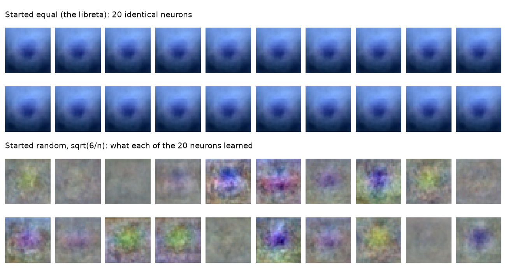
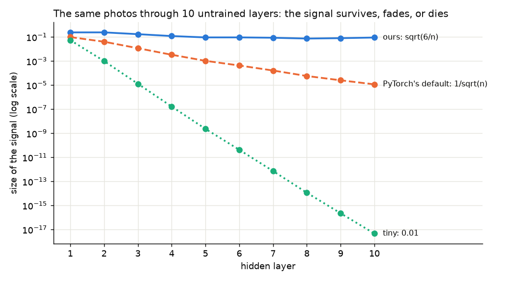

# Everyone gets the same ration

*Deep Learning from Scratch, part 4. Code: [`samples/04-initialization`](../samples/04-initialization).*

> **In short:** before a network learns anything, its weights need starting
> values, and that choice alone decides whether it learns at all. Start them all
> equal and every neuron stays a copy of its neighbor forever. Start them too
> small and the signal fades away layer by layer; too big and it blows up. The
> right size depends on how many inputs each neuron has, and with it the same
> frog network goes from 50% to 80.8%.

In March 1962 every Cuban household got a little booklet: the *libreta de
abastecimiento*, the ration book. Rice, beans, sugar, cooking oil, coffee, a
fixed amount per person per month, written down and stamped at the *bodega*
when you picked it up. Same booklet, same portions, for everyone.

The idea was equality from the start. More than sixty years later, the
libreta still exists, and a lot of Cubans would tell you what it actually
taught them: when everybody gets exactly the same, nobody has a reason or a way
to do anything different. Equal at the start, equal forever. Nobody cares.

Neural networks learned the same lesson, and you can measure it.

## Why this matters

At the end of [part 3](03-backprop.md) something odd happened. We trained the
same frog network, with the same data and the same training, twice in PyTorch.
Starting from our weights it reached **80.8%**. Starting from PyTorch's own
defaults it reached **73.6%**, worse than a single neuron. The gradients were
correct; we had checked them. The only difference was where the weights
*started*.

Every network starts from somewhere, and every framework picks that somewhere
for you, quietly. Most of the time you never look at it. But when a deep network
refuses to learn, with no error and a loss that barely moves, the starting
weights are the first suspect. This post is about why, and about the one-line
formula that fixes it.

## The experiment

Same frog photos as part 3: 10,000 to learn from, 2,000 to grade with, half
frogs. Same network (3,072 pixels → 20 → 7 → 5 → 1), same ReLU, same 40 passes
of 64 photos at a time, learning rate 0.003. Six runs. The **only** thing that
changes is how the weights start (the biases always start at zero):

```
3 hidden layers (20, 7, 5)
starting weights           train    test   signal at the start, layer by layer
all zeros                  50.0%   50.0%   0e+00 0e+00 0e+00
all equal (0.01)           61.0%   62.3%   3e+00 6e-01 4e-02
random, tiny (0.01)        50.0%   50.0%   5e-02 7e-04 1e-05
random, big (1)            63.2%   63.5%   5e+00 7e+00 1e+01
random, 1/sqrt(n)          73.2%   74.6%   1e-01 3e-02 2e-02
random, sqrt(6/n)          82.3%   80.8%   2e-01 2e-01 2e-01
```

From a coin flip to 80.8%, and the network, the data and the training are
identical in every row. The last column is the clue to all of it; we'll get
there. First, the libreta.

## Equal rations: the symmetry problem

Look at the first two rows. **All zeros** gets 50%, a coin flip. **All equal**
(every weight 0.01) gets 62.3%, *worse than a single neuron* (75.8% in part 3),
even though it has 20 + 7 + 5 neurons to work with.

Remember the two blame rules from part 3. If every neuron in a layer starts
with the same weights, they all compute the same vote for every photo. So they
all get the same blame. So they all change by the same amount. So after the
step they still have the same weights, and the whole thing repeats. Forever.
Twenty neurons in the first layer, and they behave like one neuron photocopied
twenty times.

You can see it. Each neuron in the first layer has 3,072 weights, one per pixel
value, so we can draw its weights as a 32 × 32 color picture of what it's
looking for. Here are all 20, after training:



Top: the libreta start. Twenty identical pictures, to the last decimal (the
code checks). They all learned the same smooth pattern, and twenty copies of one pattern
are worth one neuron.

Bottom: the random start. Here I drew what each neuron *learned*, its weights
after training minus where it started, because the random starting values are
just noise. Every neuron went its own way: some learned a green or yellow patch
in the middle, some a blue or purple one, a few barely changed at all. Different
starting points, different jobs.

All zeros is the libreta with nothing in it. With every weight at zero, every
ReLU outputs zero, so by rule 2 from part 3 no blame gets past the last layer.
The only thing that ever learns is the output neuron's bias, which settles on
"always say the same thing". 50%.

The fix for symmetry is easy: **start the weights random**. But random *how
big*? That's the rest of the post.

## Radio Bemba: the signal problem

In Cuba, news travels by *Radio Bemba*: word of mouth, from one neighbor to
the next. (*Bemba* is slang for lips.) It's surprisingly fast, and everybody
knows how it fails. If each person passes the story on a little less excited
than they heard it, by the tenth neighbor it's nothing. If each one adds a little,
by the tenth it's a hurricane, three arrests and a ship in the harbor.

A network is Radio Bemba with layers. Each layer takes the previous layer's
outputs, mixes them with its weights, and passes them on. If the weights are a
little too small, the signal shrinks a bit at every layer; too big, it grows.
That's the last column of the table: the typical size of each hidden layer's
outputs before any training.

- **Random, tiny (0.01):** 0.05, then 0.0007, then 0.00001. The signal
  shrinks about 70 times per layer. By the output there's nothing left to learn
  from, and nothing to pass blame back through. **50%.**
- **Random, big (1):** 5, then 7, then 10. It grows. The output neuron sees
  huge votes, so its answers start out pinned near 0 or 1, and the first
  steps are wild. **63.5%.**
- **Random, sqrt(6/n):** 0.2, 0.2, 0.2. The signal arrives at every layer the
  same size it left. **80.8%.**

## The right size, and why it depends on n

Why does the right size involve n, the number of inputs to the layer?

Think of a neuron adding up n votes, each one a random weight times an input.
Random votes partly cancel each other out, so the total doesn't grow like n;
it grows like **√n**. A first-layer neuron adds 3,072 votes. A second-layer
neuron adds 20. With the same weights, the first one's total would come out
about 12 times bigger (√3072 / √20 ≈ 12). To keep every layer's output the same
size, each weight has to shrink by √n: **more voters, quieter votes**.

Two more corrections give the exact number:

- ReLU silences about half of the neurons (the negative ones), so half of the
  signal disappears at every layer. Multiply by **2** to make up for it.
- Our random numbers are spread evenly between −1 and 1, which is a little
  narrower than the bell curve the math assumes. Multiply by **3** to match.

So each weight is a random number between −1 and 1, times **√(6 / n)**. This is
called **He initialization**, after Kaiming He, who published it in 2015 with
exactly this argument. In code it's one line:

```csharp
double scale = Math.Sqrt(6.0 / n);       // n = how many inputs this layer has
W[l][i] = rng.Uniform() * scale;
```

```python
scale = math.sqrt(6 / n)                 # n = how many inputs this layer has
W[l][k, j] = rng.uniform() * scale
```

We've been using it since part 3. Now you know where it came from.

## Deeper, and the difference grows

With three hidden layers, a bad start costs you points. With ten, it costs you
everything. Same frogs, ten hidden layers of 20 neurons each:

```
10 hidden layers of 20
starting weights           train    test   signal at the start, layer by layer
random, tiny (0.01)        50.0%   50.0%   5e-02 1e-03 1e-05 2e-07 2e-09 4e-11 7e-13 1e-14 2e-16 5e-18
random, 1/sqrt(n)          50.0%   50.0%   1e-01 4e-02 1e-02 3e-03 1e-03 4e-04 2e-04 6e-05 3e-05 1e-05
random, sqrt(6/n)          89.7%   79.6%   2e-01 2e-01 2e-01 1e-01 9e-02 9e-02 9e-02 7e-02 8e-02 9e-02
```



The tiny start loses the signal by a factor of 50 to 100 at every layer: by
layer 10 it's 0.000000000000000005. The 1/√n start is gentler, losing a factor
of 2 to 4 per layer, but ten of those add up to a factor of ten thousand, and the
network never gets going: **50%**, a coin flip. The He start keeps the signal roughly level all the
way down and trains fine.

That's why initialization didn't matter much when networks had two or three
layers, and why it became one of the things that made deep networks possible.

> **For C# and Python developers using a framework.** PyTorch's `nn.Linear`
> starts its weights at 1/√n, the orange line above, which is not the size for
> ReLU. To get He initialization, set it yourself:
> ```python
> torch.nn.init.kaiming_uniform_(layer.weight, nonlinearity="relu")   # sqrt(6/n)
> torch.nn.init.zeros_(layer.bias)
> ```
> In TorchSharp (C#) the same function exists as `torch.nn.init.kaiming_uniform_`;
> pass ReLU as the nonlinearity.
> Keras's `Dense` layer defaults to Glorot (the version of this idea for tanh and
> sigmoid); pass `kernel_initializer="he_uniform"` for ReLU.

## Three things that are easy to get wrong

**1. Trusting the framework's default.** PyTorch's 1/√n default scored 74.6%
on three layers and 50% on ten. It's not a bug, it's a general-purpose default
that isn't the one for ReLU. (In part 3 PyTorch got 73.6% instead of 74.6%
because it also starts the biases random and uses its own random numbers.) When
you build a ReLU network in any framework, check what the default is, or just
set it.

**2. "Big" doesn't look broken.** The big start reached 63.5%, well above a
coin flip, and its cost went down. If that were your first attempt you'd blame
the learning rate. There's a cheaper check: before training, push a few hundred
examples through and print the size of each layer's output, like the last
column above. Roughly the same size at every layer is healthy. Shrinking or
growing by a constant factor per layer means the start is wrong, and you'll know
in a second instead of after an hour of training.

**3. Fixing the start doesn't make deeper better.** With the right start, ten
layers trained fine, and scored **79.6%** on the test photos, a bit *less* than
three layers' 80.8%. But look at the training column: 89.7%. The deep network
got much better at the photos it trained on and no better at new ones. It's
starting to memorize. That's part 5.

## What's next

The ten-layer network knows its training photos better than it knows frogs. It's
the student who memorized the answers to the political theory exam word for
word, and can't answer a question that's phrased differently. That's called
**overfitting**, and part 5 is about two ways to fight it: L2 regularization and
dropout.

The one thing to remember: **start the weights random, so every neuron can
become different, and scaled by √(6/n), so the signal arrives at every layer
the same size it left.**

## Run it yourself

```bash
git clone https://github.com/jjcolumb/deep-learning-from-scratch
cd deep-learning-from-scratch
python data/make_frogs.py            # once: downloads CIFAR-10 (170 MB)

cd samples/04-initialization
cd csharp && dotnet run -c Release   # .NET 10, ~8 min
cd ../python && python main.py       # numpy, ~8 min
```

*Photos: CIFAR-10, Alex Krizhevsky, [Learning Multiple Layers of Features
from Tiny Images](https://www.cs.toronto.edu/~kriz/learning-features-2009-TR.pdf), 2009.
He initialization: K. He, X. Zhang, S. Ren, J. Sun, [Delving Deep into
Rectifiers](https://arxiv.org/abs/1502.01852), 2015.*
